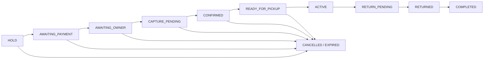

# Booking lifecycle and cancellation

## Authority and states

PostgreSQL is authoritative. Clients render projections and submit commands; scheduled dates, local
timers, and provider redirects do not establish state. `BookingStatus` is `HOLD`, `AWAITING_PAYMENT`,
`AWAITING_OWNER`, `CAPTURE_PENDING`, `CONFIRMED`, `READY_FOR_PICKUP`, `ACTIVE`, `RETURN_PENDING`,
`RETURNED`, `COMPLETED`, `CANCELLED`, or `EXPIRED`.

Occupancy, immutable pricing snapshots, handover evidence, claims, refunds, earnings, and payout
blockers are separate durable authorities. Pickup/return timestamps do not prove custody. Workers open
windows, expire deadlines, reconcile uncertain operations, and complete eligible returned bookings.

## Confirmed cancellation policy

`CARSHARE_CONFIRMED_CANCELLATION_V1` is shared by cancellation and pre-trip shortening.

- A booking confirmed at least 72 hours before pickup is refundable before `pickup - 72 hours`.
  Exactly at or inside that boundary, the rental component is non-refundable.
- A booking confirmed less than 72 hours before pickup has a grace period ending at the earlier of
  `confirmedAt + 6 hours` and pickup. The exact six-hour boundary is included, provided pickup/custody
  has not started; after it, the rental component is non-refundable.
- Renter refunds retain the snapshotted booking commission. Unperformed delivery and collection are
  evaluated independently from rental refundability. Performed delivery may be retained; unperformed
  delivery and collection may be refundable.
- Owner cancellation returns the renter's eligible amount, forfeits the affected owner earning, and
  records the configured owner penalty for recovery from future eligible payouts. Admin/platform
  cancellation is neutral unless another domain rule applies.
- Ordinary cancellation is unavailable at/after pickup or custody. Return, claim, dispute, incident,
  and support workflows remain authoritative after that point.

Preview and execution use the same server policy and immutable booking snapshots. Execution is
idempotent, records cancellation authority, adjusts financial state, releases eligible occupancy, and
emits transactional-outbox history. Cancellation does not erase evidence or bypass claims/payout
authority. If a cancellation supersedes an unapplied amendment-refund obligation, the surviving refund
is offset exactly once rather than duplicated.

API surfaces are `POST /api/v1/bookings/:reference/cancellation-preview` and `/cancellation` for the
renter, with corresponding `/api/v1/owner/bookings/...` routes for the owner. Execution requires an
`Idempotency-Key`. See [Change Booking](change-booking.md) for amendment interactions and
[financial architecture](payments-refunds-ledger.md) for settlement.
