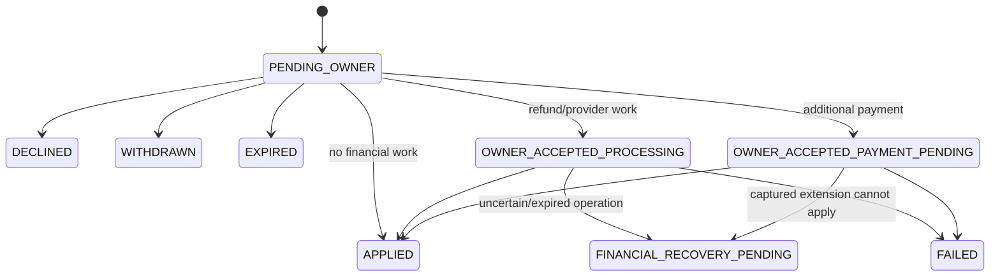

# Change Booking architecture

Change Booking is a server-authoritative amendment workflow for renter-requested pre-trip changes and
active return-time extensions. It changes an existing booking only after policy, inventory, owner, and
financial requirements have succeeded. The original booking remains authoritative until `APPLIED`.

## Model and invariants

`BookingAmendmentScope` is `PRE_TRIP` or `ACTIVE_EXTENSION`. Statuses are `PENDING_OWNER`,
`OWNER_ACCEPTED_PROCESSING`, `OWNER_ACCEPTED_PAYMENT_PENDING`, `FINANCIAL_RECOVERY_PENDING`, `APPLIED`,
`DECLINED`, `WITHDRAWN`, `EXPIRED`, and `FAILED`.

There is at most one unresolved amendment per booking. Submission atomically persists immutable
before/proposed snapshots, pricing/fulfillment calculations, status history, required net-new
`AMENDMENT_HOLD` occupancy, and an outbox event. PostgreSQL exclusion constraints remain the final
overlap authority, including racing booking and amendment submissions. Shortening does not release the
original booking occupancy early. A PRE_TRIP range may move either boundary: temporary holds protect
only a net-new earlier-start head and/or later-end tail, while application atomically replaces the
canonical range and occupancy. Search LIST and MAP treat active amendment holds as unavailable.

## Preview, submission, and decisions

Preview is read-only. It validates ownership/state, timing, fulfillment, availability, conflicts, and
complete-trip repricing, then returns a signed, expiring token. Submission revalidates the token and
current authority; stale or altered inputs fail. Idempotency keys replay the same request and reject a
different payload. Owner accept/decline is also idempotent and object-authorized.

PRE_TRIP proposals may change pickup and return together, subject to a coherent range and the accepted
minimum/maximum duration, availability, buffer, and full-trip repricing authorities. ACTIVE proposals
keep pickup immutable and may only extend return. Cancellation-equivalent refundability uses the
original captured-payment and scheduled-pickup clock, including after an applied amendment.

The booking read model exposes allowed start/end fulfillment methods and separate lifecycle
changeability flags. The allowed sets come from the latest vehicle policy but always retain the current
booked method under historical policy drift. Clients show one method read-only and offer selection only
for multiple supported, changeable methods; preview still performs final policy and serviceability
validation.

The renter editor presents PRE_TRIP dates as one range and read-only fulfillment as compact summaries.
Review shows only changed trip or handover fields plus the server-authoritative current total, proposed
economic total, and difference. Invalid or expired financial preview data cannot be submitted and is
shown as a recoverable preview error rather than being coerced to a zero amount.

The financial delta is `proposed renter total - current renter total`, in integer PHP minor units with
the same pricing/rounding authority as bookings. Positive is `ADDITIONAL_PAYMENT`, negative is
`REFUND`, and zero is `NONE`; payment and refund cannot both apply. Owner earnings and commission use
their own proposed-minus-current deltas and must conserve the renter delta.

Refundable shortening applies the cancellation timing authority in
[booking lifecycle and cancellation](booking-lifecycle-and-cancellation.md). Non-refundable removed
rental value remains committed; it is not represented as a fake cancellation fee. Fulfillment service
components are evaluated separately. Preview responses expose renter-facing totals, not owner-private
earnings or raw commission internals.

## Acceptance branches

- `NONE`: acceptance may apply atomically.
- `ADDITIONAL_PAYMENT`: acceptance enters `OWNER_ACCEPTED_PAYMENT_PENDING`. The renter payment deadline
  is `acceptedAt + 10 minutes`, from `AMENDMENT_PAYMENT_DEADLINE_MINUTES`, not booking-hold TTL. For an
  active extension it is additionally bounded by the return-workflow safety boundary. The extension is
  ineffective until captured payment is reconciled and application succeeds.
- `REFUND`: acceptance enters `OWNER_ACCEPTED_PROCESSING`. The refund obligation and provider operation
  are correlated to the original captured rental payment. Application waits for confirmed settlement.

If no valid payment begins before the renter deadline, the amendment fails and releases its holds.
If payment began on time but provider truth is unknown, `PaymentOperation.UNKNOWN`,
`reconciliationRequired`, `reconcileAfter`, `unknownExpiresAt`, and the provider-uncertainty grace—not
the renter deadline—control recovery. Holds remain while application is legitimately possible.

For active extensions, the original return remains authoritative until application. A captured charge
that cannot apply because return authority advanced is not silently failed: it enters
`FINANCIAL_RECOVERY_PENDING`, preserves financial evidence, and drives a refund. Operational expiry may
release inventory while retaining the durable recovery obligation.

## Application and recovery

Application serializes the booking, amendment, payment/refund, earning, and hold authorities. It
revalidates state and conservation, updates scheduled times and booking snapshots, converts/releases
holds, adjusts owner earning, posts balanced ledger entries, writes status history, and emits outbox
events in one transaction. A failure rolls back the whole application.

The rental-operations worker expires unanswered requests and missed payment windows. Payment
reconciliation resolves uncertain captures; amendment-application reconciliation retries ready work;
refund execution/reconciliation retries provider operations; and operational-expiry processing moves
unresolved refund cases to financial recovery without losing them. Repeated runs are idempotent.

Admin diagnostics provide the amendment list/detail and finance evidence. Manual refund resolution is
allowed only through the audited endpoint and requires authoritative provider evidence; it never means
editing financial rows directly. See the [operator runbook](../development/manual-amendment-refund-reconciliation.md).

## API and errors

Renter routes below `/api/v1/bookings/:reference` are:

- `POST amendment-preview`, `POST amendments` (submission requires `Idempotency-Key`)
- `GET amendments/:amendmentReference`, `POST .../withdraw`
- `POST .../payment` (requires `Idempotency-Key`), `POST .../refund`

Owner routes below `/api/v1/owner/bookings` include the unchanged `GET amendments/actionable`,
amendment detail, and idempotent `accept`/`decline`. The bounded `GET amendments` read model supports
`NEEDS_RESPONSE`, `UPCOMING`, and `ALL`: Needs response is exactly `PENDING_OWNER`; Upcoming is an
accepted in-progress, applied, or recovery amendment whose booking is capture-pending, confirmed,
ready for pickup, active, or return-pending; All is the complete Owner-visible state set. Results are
ownership-scoped and ordered by newest amendment activity. Admin uses
`GET /api/v1/admin/bookings/amendments` and `.../:id`.
Relevant stable booking errors include `AMENDMENT_ALREADY_PENDING`, `AMENDMENT_PREVIEW_INVALID`,
`NO_CHANGES`, `UNSUPPORTED_CHANGE`, `BOOKING_STATE_CHANGED`, `DATES_UNAVAILABLE`,
`FULFILLMENT_UNAVAILABLE`, `PREPARATION_TIME_CONFLICT`, and idempotency errors.

Mobile renter and owner surfaces consume these projections and invalidate/refetch booking, amendment,
availability, and earnings queries after commands. They do not calculate authoritative prices or
transitions. Admin exposes operational history, settlement state, provider evidence, and recovery.

## Migration and verification history

The foundation is migrations 65–72: amendment foundation; hold-release corrections; owner-accepted
processing; refund correlation; refund suspense; operational expiry; and cancellation/refund offset.
Applied migrations are immutable and Migration 73 must not be invented for documentation work.

Coverage spans preview boundaries and conservation, authorization/privacy, submission concurrency and
rollback, owner decisions, payment deadlines, provider uncertainty, refund recovery/manual evidence,
active-extension return races, cancellation offset, discovery holds, worker idempotency, mobile flows,
and Admin projections. Use a configured isolated local test database for mutation-capable integration
tests; never point those tests at development or shared environments.

## Rollout and rollback

Apply committed migrations before starting API/workers that require their schema, following the
repository's existing migration-deploy process. Roll out compatible API and rental-operations workers
together so new amendment states have expiry, payment, application, refund, and reconciliation
consumers. Mobile and Admin are API clients and may roll after compatible server projections exist;
older clients must remain unable to invent state.

Before rollout, confirm payment/refund reconciliation and rental-operations workers are running against
the same database as the API, fake providers are not selected outside local/test, and migration status
has no pending/failed/checksum mismatch. Monitor unknown operations, financial-recovery amendments,
outbox failures, expired deadlines, and payout blockers. A service rollback must preserve applied
migrations and durable obligations; never edit/down-migrate applied history or discard holds, payments,
refunds, evidence, or ledger rows. If older services cannot safely interpret newly reachable states,
stop commands and continue reconciliation with a compatible worker/API rather than forcing database
state.
