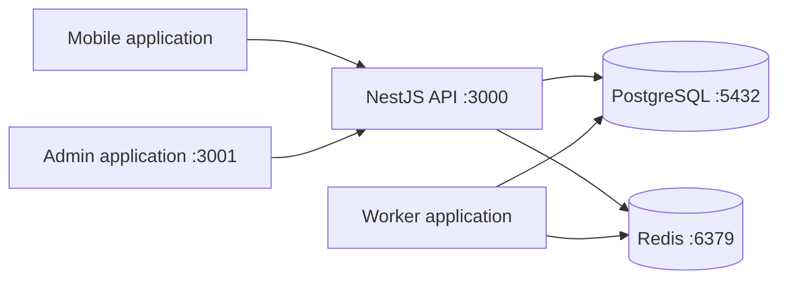

# Platform foundation

## Runtime topology

PostgreSQL is the future authoritative store for business and financial state. Redis is restricted to
ephemeral coordination, caching, throttling, OTPs, and queues. Phase 1 does not create business
tables or register business jobs.

## API foundation

- Version prefix: `/api/v1`
- Swagger UI: `/docs`
- OpenAPI JSON: `/docs/openapi.json`
- Success envelope: `{ "success": true, "data": ... }`
- Error envelope: `{ "success": false, "error": { "code": "...", "message": "..." } }`
- Correlation header: `x-correlation-id`
- Structured JSON logs with redaction of credentials and tokens
- Liveness does not check dependencies; readiness checks PostgreSQL and Redis

## Process boundaries

The API and worker are independently deployable processes from one modular-monolith codebase. The
worker must not become an independent owner of domain state. Future queued changes use a
transactional outbox written in the same PostgreSQL transaction as their originating business event.
